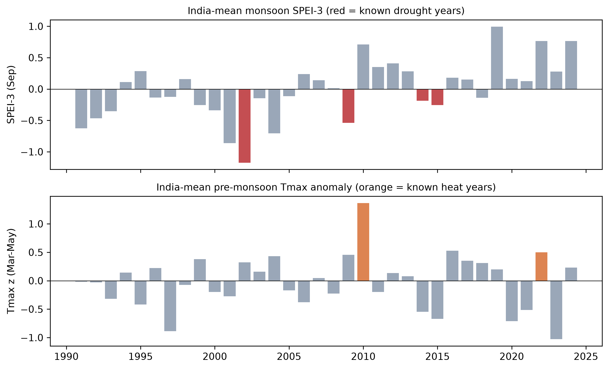
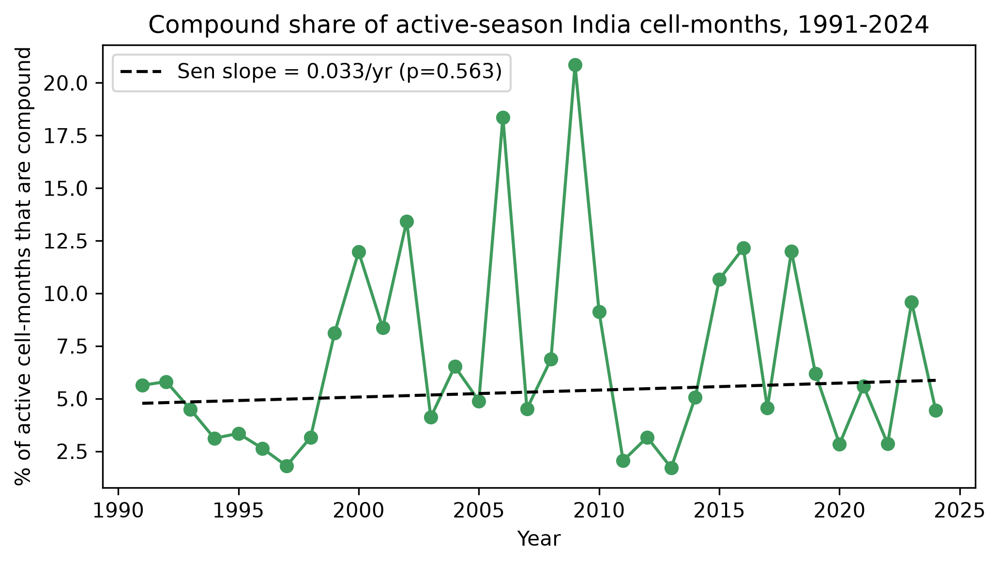
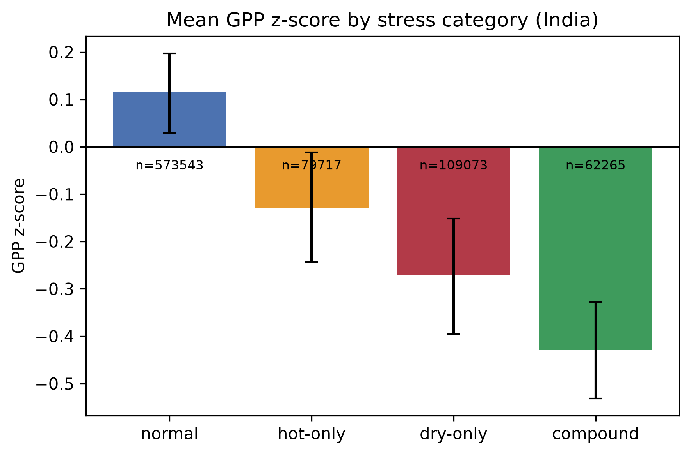
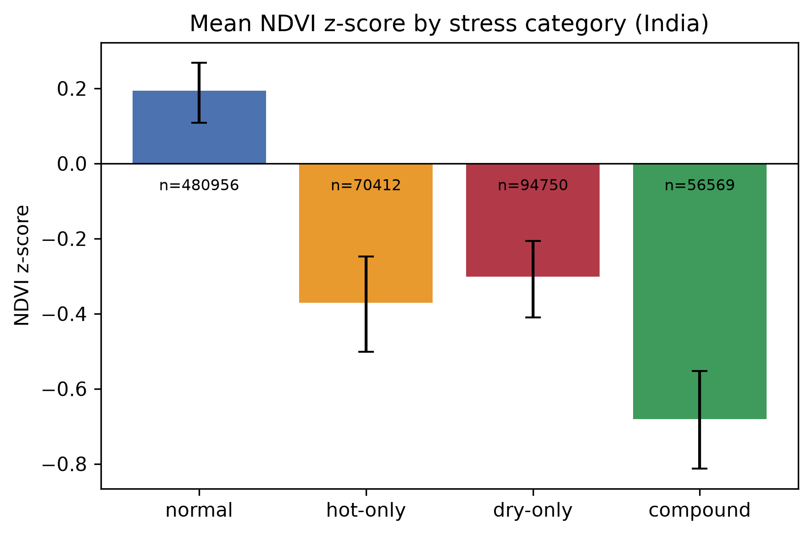
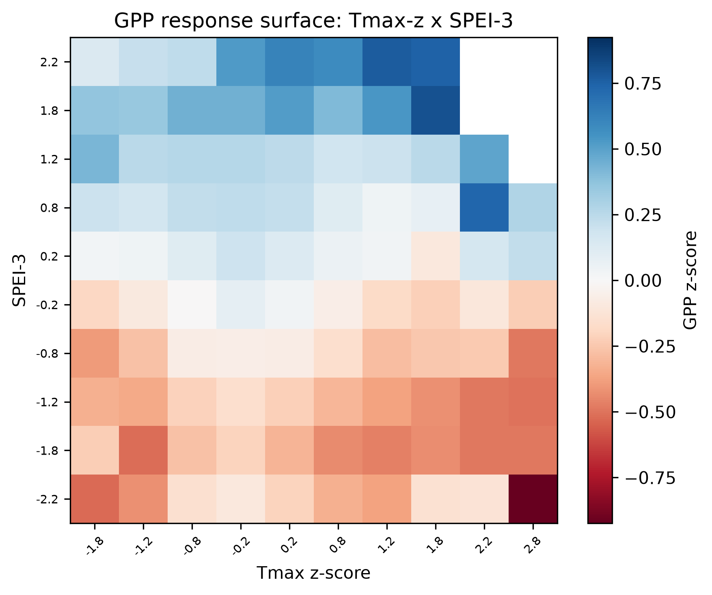
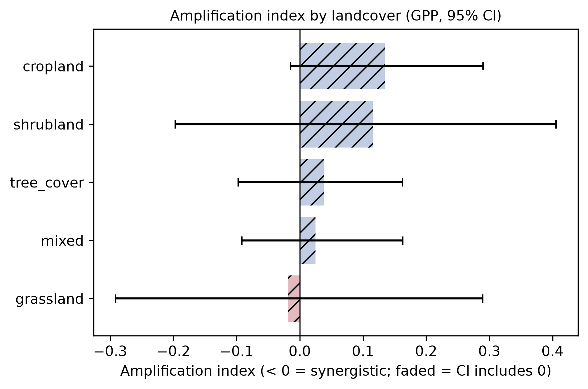
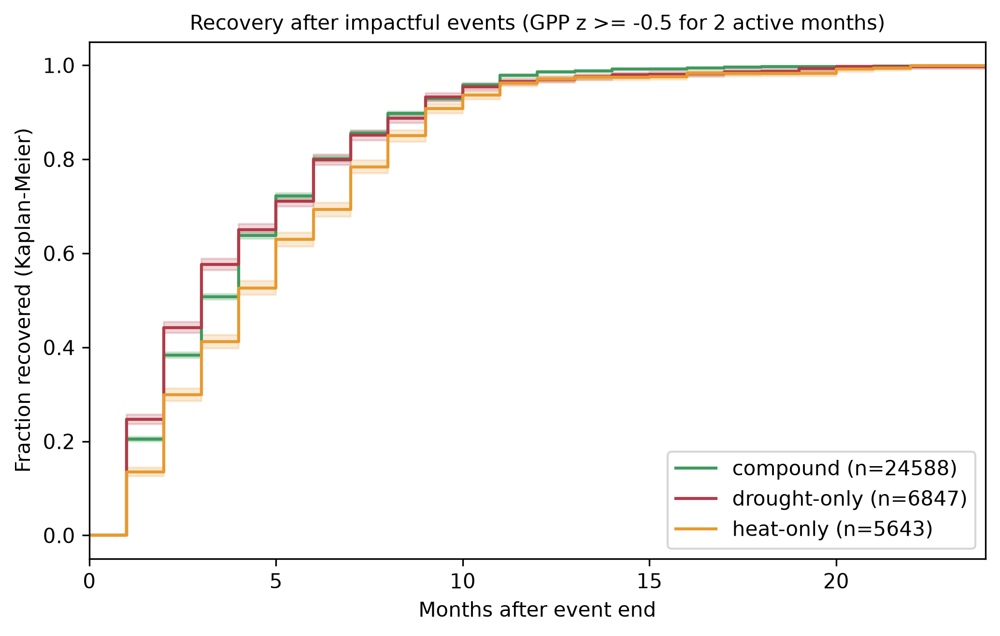
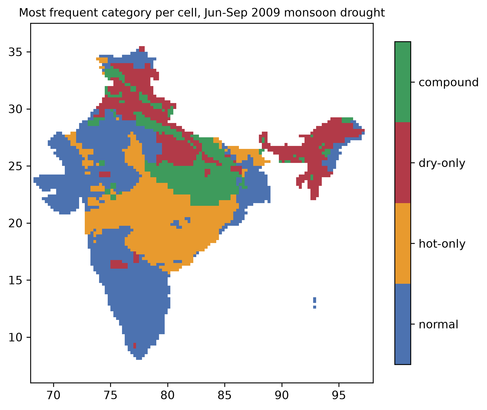

# Compound Heat–Drought Stress over India — EVS Project #19

**Team:** Arnav Deshmukh, Ayush Brajesh Roy, Saksham Chitkara, Gracy Garg, Rudra Choudhary (IIIT Hyderabad)

> **Final submission update (India + Australia).** The analysis now covers Australia as well, with p-values for every result. The final deck is `slides/final_themed.pptx` (PDF alongside). Setup, run order and final results are in [`HANDOFF.md` section 0](HANDOFF.md). The rest of this README describes the mid-evaluation; two of its conclusions changed after year-level significance tests: H3 (slower recovery after compound events) is **not** supported (Cox HR 0.91, p = 0.30), and the India GPP compound vs dry-only gap is weaker than reported. Mid-evaluation outputs are frozen in `_midsub_snapshot/`. The `data/` folder is not in the repo; rebuild it with `scripts/01_fetch.py` and `scripts/02_build_cube.py` (set `CHD_REGION=australia` for Australia).

This folder has everything for the mid-evaluation: data, code, results, figures, slides and a live demo notebook. Read sections 1 and 2 to get it running. The rest explains what we did and what we found, so everyone can answer questions on any part.

---

## Contents

1. [Quick start (5 minutes)](#1-quick-start-5-minutes)
2. [Step-by-step setup](#2-step-by-step-setup)
3. [Running everything else (tests, pipeline, slides)](#3-running-everything-else)
4. [The demo notebook (`demo.ipynb`) explained](#4-the-demo-notebook-demoipynb-explained)
5. [Problem statement](#5-problem-statement)
6. [What was done for the mid-evaluation](#6-what-was-done-for-the-mid-evaluation)
7. [What is left for the final presentation](#7-what-is-left-for-the-final-presentation)
8. [Data](#8-data)
9. [Methods and results, analysis by analysis](#9-methods-and-results-analysis-by-analysis)
   - [9.1 Basic definitions](#91-basic-definitions)
   - [9.2 QC: do the inputs reproduce known events?](#92-qc-do-the-inputs-reproduce-known-events)
   - [9.3 H5: are compound conditions becoming more frequent?](#93-h5-are-compound-conditions-becoming-more-frequent)
   - [9.4 H1: impact by stress category](#94-h1-impact-by-stress-category)
   - [9.5 H2: is the combination worse than the sum?](#95-h2-is-the-combination-worse-than-the-sum)
   - [9.6 H4: land cover and region](#96-h4-land-cover-and-region)
   - [9.7 Mechanism: soil moisture and air dryness](#97-mechanism-soil-moisture-and-air-dryness)
   - [9.8 H3: recovery after events](#98-h3-recovery-after-events)
   - [9.9 Case study: 2009](#99-case-study-2009)
10. [Overall conclusions (as on the slides)](#10-overall-conclusions-as-on-the-slides)
11. [Limitations](#11-limitations)
12. [How this compares with the literature (honest novelty)](#12-how-this-compares-with-the-literature-honest-novelty)
13. [Folder structure](#13-folder-structure)
14. [Troubleshooting](#14-troubleshooting)
15. [Glossary](#15-glossary)

---

## 1. Quick start (5 minutes)

- **To present: `slides/midsub_v4.pdf` (28 slides) is the latest deck.** You don't need to install anything to open it. It follows the team's feedback:
  - numbered citations;
  - a GPP / carbon sink-vs-source slide;
  - the problem statement and our questions on separate slides;
  - methodology as Workflow → Step 1 data → Metrics → Step 2 anomalies → Step 3 four boxes → Step 4 how H1/H2 are tested;
  - results for H1–H2 only, with an explained response surface;
  - things left to do: the H2 regression, plus H3, H4 and repeating the analysis for another country.
- **Older versions** (all use the same numbers; v4 replaces them):
  - `slides/midsub.pdf` (25 slides): the original deck, with all of H1–H5 as results.
  - `slides/midsub_v2.pdf` (29 slides): the same structure as v4, with more text.
  - `slides/midsub_v3.pdf` (25 slides): a short, minimal-text version of v2.
- **To run the live demo:**
  1. Do the setup in [section 2](#2-step-by-step-setup) once.
  2. Open the `midSub` folder in VS Code.
  3. Open `notebooks/demo.ipynb`.
  4. Pick the kernel **"Python (est-midsub)"** at the top right.
  5. Click **Run All**.

## 2. Step-by-step setup

You need **Python 3.12 or newer** (we use 3.13). Python 3.11 will **not** work, because the pinned numpy and scipy need 3.12+.

### Windows (PowerShell, e.g. the VS Code terminal: Ctrl + `)

```powershell
# 0. Check your Python version (must print 3.12.x or 3.13.x)
python --version
#    If you have several Pythons installed, list them and pick one with: py -0
#    then use e.g.  py -3.13  instead of  python  in step 2.

# 1. Go to the project folder (wherever you unzipped it)
cd "C:\path\to\midSub"

# 2. Create a virtual environment OUTSIDE OneDrive/Dropbox (syncing can lock files)
python -m venv $HOME\venvs\est-midsub

# 3. Activate it (your prompt should now start with "(est-midsub)")
& "$HOME\venvs\est-midsub\Scripts\Activate.ps1"
#    If this says "running scripts is disabled", run this once, then retry step 3:
#    Set-ExecutionPolicy -Scope CurrentUser RemoteSigned

# 4. Install the packages
python -m pip install --upgrade pip
pip install -r requirements.txt

# 5. Register this environment as a Jupyter kernel (the notebook looks for this exact name)
python -m ipykernel install --user --name est-midsub --display-name "Python (est-midsub)"

# 6. Check it worked: should print OK
python -c "import xarray, netCDF4, lifelines, ipywidgets; print('OK')"
```

### macOS / Linux

```bash
python3 --version                      # must be 3.12+
cd /path/to/midSub
python3 -m venv ~/venvs/est-midsub
source ~/venvs/est-midsub/bin/activate
python -m pip install --upgrade pip
pip install -r requirements.txt
python -m ipykernel install --user --name est-midsub --display-name "Python (est-midsub)"
python -c "import xarray, netCDF4, lifelines, ipywidgets; print('OK')"
```

### Open the notebook

**In VS Code** (needs the "Python" and "Jupyter" extensions):
1. Use **File → Open Folder…** and choose the `midSub` folder.
2. Open `notebooks/demo.ipynb`.
3. At the top right, click the kernel name, choose **Select Another Kernel… → Jupyter Kernel… → Python (est-midsub)**, then click **Run All**.

**Without VS Code:**
1. Run `pip install jupyterlab` in the activated environment.
2. Run `jupyter lab` from the `midSub` folder.
3. Open `notebooks/demo.ipynb` and choose the "Python (est-midsub)" kernel.

The first cell prints `Python running this notebook: ...`. If that path is **not** inside `venvs\est-midsub`, the wrong kernel is selected (see [Troubleshooting](#14-troubleshooting)).

## 3. Running everything else

Always activate the environment first (step 3 above) and run commands from the `midSub` folder.

| What | Command | Notes |
|---|---|---|
| Automated tests | `python -m pytest tests -q` | Should say **68 passed**. Uses synthetic data only. |
| Rebuild the data cube | `python scripts/02_build_cube.py` | Reads `data/raw/` (no internet). Writes `data/processed/cube.nc` (1.4 GB) and QC figures. Takes several minutes. **Needed if the zip didn't include `cube.nc`.** |
| Events + trend | `python scripts/03_indices_events.py` | Writes `data/processed/events.csv`, frequency maps, trend. |
| Impact + synergy | `python scripts/04_impacts.py` | All H1/H2/H4 tables and figures. |
| Recovery | `python scripts/05_recovery.py` | Kaplan–Meier, log-rank, severity-matched, epoch composites. |
| 2009 case study | `python scripts/06_case_studies.py` | Maps + India-mean monthly series. |
| Print every slide number | `python slides/extract_numbers.py` | Reads `results/`. `slides/NUMBERS.md` maps each slide claim to its file. |
| Rebuild the slides | `cd slides` then `pdflatex midsub_v4`, `bibtex midsub_v4`, `pdflatex midsub_v4`, `pdflatex midsub_v4` (same for the other versions) | Needs LaTeX with beamer, pgf/tikz, multirow, natbib. Figures are read from `../figures/`. On Overleaf, upload `figures/` too and change `\FigPath` in `midsub.tex`. |
| Rebuild the notebook file | `python notebooks/build_demo_notebook.py` | The `.ipynb` is generated from this script. Edit the script, not the notebook. |

**Downloading the data again from Google Earth Engine (optional):** all the data is already cached in `data/raw/`, so you shouldn't need to. If you do:
1. Get an Earth Engine account and a registered Cloud project.
2. Run `earthengine authenticate`.
3. Set `EE_PROJECT` to your project ID.
4. Run `python scripts/00_check_gee.py`, then `python scripts/01_fetch.py`. This takes about an hour, and files already in `data/raw/` are skipped.

## 4. The demo notebook (`demo.ipynb`) explained

It reads only saved files (`data/processed/cube.nc`, `results/`, `figures/`) and makes no internet calls, so it can't fail on bad Wi-Fi during the evaluation.

| Section | What it shows | What to say |
|---|---|---|
| **Setup cell** | Finds the project folder, prints which Python is running, loads the data cube and lists its variables. | "One cube: 22 years × 126 × 120 grid cells, with every variable on the same 0.25° grid." |
| **1. Month picker** | Sliders for year and month. Draws 4 India maps for that month: Tmax anomaly, SPEI-3 (drought index), GPP anomaly, and stress category (blue normal / orange hot-only / red dry-only / green compound). Opens on **July 2009**. | Move to a drought month and show that dry and compound areas line up with low GPP. Try May 2010 (record heat) or a monsoon month. |
| **2. Location picker** | Picks one of 3 grid cells (Western Ghats evergreen forest; central India; Punjab cropland). Plots GPP anomaly 2001–2022, with hot-only / dry-only / compound months shaded. | Show how GPP dips in shaded compound months, and how forests vs cropland differ. |
| **3. Headline results** | The result tables behind the slides: category means, contrasts with 95% CIs, SPEI vs SPI robustness, Peninsular vs North, Kaplan–Meier recovery, severity-matched recovery, trend. | Numbers to point at when asked "how do you know?". |
| **4. Response surfaces** | The GPP and NDVI response-surface figures (Tmax z × SPEI-3). | Productivity falls mainly along the dry axis, and the hot + dry corner is the lowest. |
| **5. Live Earth Engine call** | Off by default (`RUN_LIVE_EE_CHECK = False`). | Only switch on if you have your own Earth Engine project set up. |

Sections 1 and 2 are interactive, so they appear only after you run the notebook. Sections 3 and 4 are also saved in the file.

## 5. Problem statement

**Assigned topic (#19):**
> **Compound Heat–Drought Stress: Are Ecosystems Experiencing Stronger Combined Impacts?**
> Research question: Does simultaneous heat and drought produce greater ecosystem stress than either disturbance occurring independently? The study can compare ecosystem productivity and recovery during compound and single-stressor events.
> Open datasets: ERA5-Land; CHIRPS; SPEI; MODIS GPP/NDVI; ESA WorldCover.

**How we framed it:** all of India, monthly, on a 0.25° grid (about 27 km). Climate covers 1991–2024; vegetation covers 2001–2022. Five testable hypotheses:

| | Hypothesis | Answer at mid-eval |
|---|---|---|
| **H1** | Productivity (GPP) and greenness (NDVI) are lower in compound months than in hot-only or dry-only months | **Supported** |
| **H2** | The compound effect is *synergistic*: worse than heat damage + drought damage added together | **Not supported**: roughly additive |
| **H3** | Ecosystems recover more slowly after compound events than after droughts | **Modestly supported**: about 1 month slower at the median |
| **H4** | The response differs by land cover and region | Partly: damage size differs; synergy doesn't appear anywhere |
| **H5** | Compound conditions are becoming more frequent | **Not supported**, 1991–2024, by our monthly definition |

We also check that the results don't depend on the drought index by repeating H1 and H2 with SPI-3 instead of SPEI-3.

## 6. What was done for the mid-evaluation

The mid-eval asks for about 50–60% of the work, covering Problem, Data, Methodology, Results and Observations (see `instructions.md`). Done:

- **Data:**
  - Downloaded all five suggested datasets via Google Earth Engine and aggregated them to a common 0.25° grid over India: 150 cached files in `data/raw/`.
  - Built one analysis "cube" (`data/processed/cube.nc`).
- **Data QC:**
  - The inputs reproduce known Indian drought years (2002, 2009) and heat years (2010, 2022).
  - The GPP map matches known vegetation patterns.
- **Stress classification** of every India grid-month into normal / hot-only / dry-only / compound.
- **H1:** impact by category for GPP and NDVI, with 95% confidence intervals.
- **H2:** additivity test (amplification index) and response surface, plus an SPI-3 robustness check.
- **H4:** the same tests by land cover (ESA WorldCover) and region (Peninsular vs North India), plus a direct Peninsular − North test.
- **Mechanism check:** soil moisture and vapour-pressure deficit by category.
- **H3:** event detection (66,201 events), recovery times with Kaplan–Meier (handles unfinished recoveries), a severity-matched comparison, and superposed-epoch composites.
- **H5:** trend in compound frequency, 1991–2024.
- **2009 case study.**
- **Literature positioning:**
  - Checked novelty against 2024–2026 papers.
  - Verified every citation's DOI.
  - Found and corrected citation errors from our lit review.
- **Verification:**
  - 68 automated tests.
  - Every slide number traced to a results file (`slides/NUMBERS.md`).
  - Several real bugs found and fixed during an audit (for example, statistics that leaked in data from neighbouring countries, and a leap-year error in monthly GPP). Details are in `HANDOFF.md`.
- **Deliverables:** the slide deck (`slides/midsub_v4.pdf`; older versions `midsub.pdf`, `_v2`, `_v3`) and the demo notebook (`notebooks/demo.ipynb`).

## 7. What is left for the final presentation

1. **Recovery drivers.** What controls recovery time: rain after the event, or air dryness (VPD)? Studies disagree (Yao 2024 vs Huang & Zhai 2025 vs Feng 2026), so a regression of recovery time on post-event rainfall, VPD, severity and land cover would settle it for India.
2. **Stricter compound definition.** Right now a drought is "compound" if *any* of its months is hot. Re-run with "≥50% of months hot". Also try daily heatwave definitions so our trend result can be compared with studies that find increases.
3. **Independent productivity data.** Check the forest GPP vs NDVI disagreement with a GPP product built differently from MODIS MOD17. Options: PML_V22a (already set up in `chd/config.py`) or SIF-based GOSIF.
4. **Probability-based amplification.** Meena et al. 2026 measure "amplification" as a change in *probability* of vegetation drought; we use *mean* anomalies. Compute their kind of metric too so the two results can be compared directly.
5. **Deciduous vs evergreen forests** in Peninsular India (MODIS MCD12Q1 land cover).
6. **Per-cell synergy map** (where in India, if anywhere, is the effect super-additive?).
7. **More case studies:** 2015 drought and the 2022 pre-monsoon heatwave.
8. **Sensitivity runs:**
   - Thresholds at 1.28 SD instead of 1.
   - SPEI-1 and SPEI-6 (already downloaded).
   - Detrended temperature.
   - A 1-month lag.
   - A soil-moisture-based drought definition.
   - Stricter land-cover purity.
   - Early vs late period.
9. **Improve the H2 test with a regression** instead of four boxes: GPP z = a·heat + b·dryness + c·(heat × dryness), using every month's actual values. If c < 0, the effect is synergistic. This is on the v4 slides as planned work.
10. **Repeat the analysis for another country** (not chosen yet), to see whether India's "additive" result holds elsewhere. All our datasets are global (CHIRPS covers 50°S–50°N), so mostly the grid and the country mask need changing (`chd/config.py`).
11. **Final report**, with the corrected citations (see [section 12](#12-how-this-compares-with-the-literature-honest-novelty)).

## 8. Data

All data was aggregated on Google Earth Engine to a 0.25° grid covering 68–98°E, 6–37.5°N (120 × 126 cells).

| Dataset | Earth Engine asset | What we use | Period | Role |
|---|---|---|---|---|
| ERA5-Land (reanalysis) | `ECMWF/ERA5_LAND/DAILY_AGGR` | Daily max temperature → monthly mean; soil moisture 0–100 cm; air temperature + dewpoint → VPD | 1991–2024 | Defines "hot"; mechanism check |
| CHIRPS v2 (rainfall) | `UCSB-CHG/CHIRPS/PENTAD` | Monthly rainfall → SPI-3 | 1991–2024 | Temperature-free drought index (robustness) |
| SPEI v2.11 | `CSIC/SPEI/2_11` | SPEI-3 | 1991–2024 | Defines "dry" (main drought index) |
| MODIS MOD17A2H v006 | `MODIS/006/MOD17A2H` | Gross Primary Productivity (8-day → monthly) | 2001–2022 | **Main response**: how much carbon plants fix |
| MODIS MOD13A3 v061 | `MODIS/061/MOD13A3` | NDVI + quality flag | 2001–2022 | **Second response**: canopy greenness |
| ESA WorldCover v200 | `ESA/WorldCover/v200` | Land-cover fractions per cell | 2021 | Land-cover strata; vegetation mask |
| USDOS LSIB 2017 | `USDOS/LSIB_SIMPLE/2017` | India boundary | — | Which cells are "India" |

Notes:
- **India cells:** only cells at least 50% inside India are used for statistics (4,481 cells).
- **GPP version:** MOD17A2H v006 is used because the newer v061 8-day product on Earth Engine only starts in 2021.
- **GPP and NDVI share a sensor:** both come from the MODIS Terra satellite, so they are two products of one sensor, not independent sensors.
- **NDVI quality:** cell-months whose quality flag says mostly cloudy or snow are dropped (14.6% of active cell-months).

## 9. Methods and results, analysis by analysis

The code is in `chd/` and runs through `scripts/02`–`06`. Every threshold is in `chd/config.py`.

### 9.1 Basic definitions

**Anomaly (z-score).** For each grid cell and calendar month, a value is turned into a z-score: how many standard deviations it is above or below what is normal *for that cell in that month*. This removes the seasonal cycle, so a dry-season month isn't flagged just for being dry season.
- **Temperature:** compared against 1991–2020. It is *not* detrended, so long-term warming counts as heat.
- **GPP and NDVI:** a linear trend is removed first, so greening from CO₂ or irrigation isn't counted as an anomaly. They are standardised over 2001–2022.

**Drought indices:**
- **SPEI-3** (main) compares 3-month rainfall with 3-month evaporative demand. Below −1 means unusually dry. Its evaporation term depends on temperature, so "dry" is partly heat-driven.
- **SPI-3** (robustness) uses rainfall only (CHIRPS, gamma distribution fitted on 1991–2020), so it is independent of temperature.

**Stress categories (per grid-month):**

| | SPEI-3 > −1 | SPEI-3 ≤ −1 |
|---|---|---|
| **Tmax z < 1** | Normal | Dry-only |
| **Tmax z ≥ 1** | Hot-only | **Compound** |

**Active months only.** A grid-month is counted only if all three hold:
- the cell is in India;
- the cell is at least 50% vegetated (WorldCover);
- normal GPP for that calendar month is at least 30% of the cell's peak month.

This removes deserts and dormant seasons, where "low GPP" means nothing. That leaves **824,598 grid-months** (normal 573,543; dry-only 109,073; hot-only 79,717; compound 62,265).

**Statistics:**
- **Year-block bootstrap.** All uncertainty ranges are 95% confidence intervals from 1,000 replicates. Each replicate resamples whole *years* with replacement, because cells within the same year are not independent. Resampling individual grid-months would make the intervals far too narrow.
- **Significance.** A difference is called significant when its 95% CI excludes zero.

**Amplification index (AI)** tests additivity:

AI = Δcompound − (Δhot + Δdry), where each Δ is the category mean minus the normal mean.

- If AI < 0, compound damage is *bigger* than the sum (synergy).
- If AI ≈ 0, it is additive.
- If AI > 0, it is *less* than the sum (sub-additive).

### 9.2 QC: do the inputs reproduce known events?

- **Procedure:**
  - India-mean SPEI-3 at the end of the monsoon (September), for every year 1991–2024.
  - India-mean pre-monsoon (March–May) temperature anomaly.
- **Result:**
  - Known drought years: 2002 is the **driest** of 34 years and 2009 the **5th driest**. 2015 and 2014 are milder (10th, 11th).
  - Known heat years: Mar–May 2010 is the **hottest** of 34 years and 2022 the **3rd**.
  - The GPP map is high in the Western Ghats and North-East and low in the Thar desert.
- **Inference:** the data pipeline reproduces real events, so the inputs can be trusted.



### 9.3 H5: are compound conditions becoming more frequent?

- **Procedure:**
  - For each year 1991–2024, compute the % of active India grid-months that are compound.
  - Trend: Sen's slope (a robust slope) and Mann–Kendall test (is there a monotonic trend?).
- **Result:**
  - Slope +0.03 percentage points per year (95% CI −0.09 to +0.16), p = 0.56.
  - Peak years: 2009 (20.9%), 2006 (18.4%), 2002 (13.4%).
- **Inference:**
  - **No significant trend.** The record is dominated by a few extreme years.
  - This **differs** from India studies that report increases (Sharma & Mujumdar 2017; Bhattacharjee & Dhanya 2026). Those start in 1951 and use daily heatwave definitions; ours is monthly, from 1991, and covers active vegetation months only. Say this explicitly if asked.



### 9.4 H1: impact by stress category

- **Procedure:** mean GPP z and NDVI z in each category, with 95% CIs, and the differences between categories.
- **Result:**

| Mean z (95% CI) | Normal | Hot-only | Dry-only | Compound |
|---|---|---|---|---|
| **GPP** | +0.12 | −0.13 [−0.24, −0.01] | −0.27 [−0.40, −0.15] | **−0.43** [−0.54, −0.33] |
| **NDVI** | +0.19 | −0.37 [−0.50, −0.26] | −0.30 [−0.41, −0.21] | **−0.68** [−0.81, −0.55] |

- Compound minus dry-only: GPP −0.16 [−0.26, −0.04], NDVI −0.38 [−0.49, −0.28].
- Compound minus hot-only: GPP −0.30 [−0.40, −0.21], NDVI −0.31 [−0.43, −0.21].
- The result holds with SPI-3 instead of SPEI-3: compound − dry-only is GPP −0.26, NDVI −0.48.
- **Inference: H1 supported.** All three stress types are significantly below normal, and compound months are significantly worse than either single stress, in both GPP and NDVI.

| GPP | NDVI |
|---|---|
|  |  |

### 9.5 H2: is the combination worse than the sum?

- **Procedure:**
  - Amplification index with a joint bootstrap CI, computed for both drought indices.
  - Response surface: mean GPP z in bins of Tmax z × SPEI-3; bins with fewer than 30 values are blanked.
- **Result:**

| Amplification index (95% CI) | with SPEI-3 | with SPI-3 |
|---|---|---|
| GPP | +0.09 [−0.03, +0.21] | −0.00 [−0.12, +0.13] |
| NDVI | +0.18 [+0.06, +0.30] | +0.06 [−0.05, +0.18] |

- **Inference: H2 not supported.**
  - The AI is never significantly negative, overall or in any land cover or region (section 9.6). Heat and drought damages roughly **add up**; the compound case is not worse than the sum.
  - With SPEI-3, NDVI is even slightly *sub*-additive, but this disappears with SPI-3. So the drought definition changes this part of the conclusion.
  - The response surface shows productivity falling mainly as conditions get drier. The hot + dry corner is lowest, while warm + wet months show *higher* GPP.



### 9.6 H4: land cover and region

- **Procedure:**
  - The same contrasts per dominant land cover (a cell is "mixed" if no class covers ≥50%) and per region (Peninsular = south of 22°N).
  - A direct bootstrap test of Peninsular minus North for each stress effect.
- **Result (GPP):**

| Land cover | Compound mean | Dry-only | Hot-only | AI (95% CI) |
|---|---|---|---|---|
| Shrubland | −0.75 | −0.30 | −0.36 | +0.12 [−0.19, +0.38] |
| Cropland | −0.61 | −0.30 | −0.28 | +0.13 [−0.01, +0.28] |
| Grassland | −0.60 | −0.26 | −0.19 | −0.02 [−0.31, +0.28] |
| Mixed | −0.46 | −0.24 | −0.13 | +0.02 [−0.10, +0.16] |
| Tree cover | −0.03 | −0.21 | **+0.17** | +0.04 [−0.11, +0.16] |

- **Peninsular minus North:**
  - NDVI: Peninsular is more sensitive to every stress type. Compound effect −0.40 beyond the North (CI −0.69 to −0.10); hot-only −0.32; dry-only −0.24; all significant.
  - GPP: no significant regional difference.
- **Inference:**
  - **No land cover or region shows synergy** in GPP; all AI CIs include 0.
  - Compound damage is largest in **shrubland and cropland**.
  - **Forests disagree between metrics.** Tree-cover GPP is *above* normal in hot-only months (+0.15, CI +0.06 to +0.23), and compound is *less* bad than dry-only (+0.18, CI +0.03 to +0.33). Yet tree-cover NDVI shows compound *worse* than dry-only (−0.25).
    - A likely cause is how MOD17 GPP is computed: it is driven by radiation and air dryness and has no soil-moisture input.
    - Satellite GPP is known to under-respond to extremes in forests (Flach et al. 2021).
    - Checking this with an independent GPP product is final-phase work.



### 9.7 Mechanism: soil moisture and air dryness

- **Procedure:** mean root-zone soil moisture z and VPD z (vapour-pressure deficit, i.e. how "thirsty" the air is) in each category.
- **Result:**

| | Normal | Hot-only | Dry-only | Compound |
|---|---|---|---|---|
| Soil moisture z | +0.29 | −0.75 | −0.38 | **−1.04** |
| VPD z | −0.38 | +1.11 | +0.18 | **+1.43** |

- **Inference:**
  - Compound months combine the driest soils *and* the thirstiest air, which is why they hurt most.
  - Hot-only months also have quite dry soils, drier than SPEI-dry months. So rainfall-based drought indices (SPEI, SPI) miss part of the real soil water stress. This links to the literature debate on atmospheric vs soil-based drought definitions (Liang et al. 2026).

### 9.8 H3: recovery after events

- **Procedure:**
  - **Events:** runs of at least 2 months.
    - Drought event: SPEI-3 ≤ −1. It is "compound" if any of its months is hot.
    - Heat-only event: hot months with no drought.
    - This gives 66,201 events: compound 36,650; drought-only 17,881; heat-only 11,670.
  - **Impactful events** are those where GPP z fell to −1 or lower: 24,588 compound, 6,847 drought-only, 5,643 heat-only.
  - **Recovered** = GPP z back to ≥ −0.5 for 2 active months in a row.
  - **Censoring:** some events never get a full recovery window, because a new event starts, the record ends, or 24 months pass. Those are "censored", and **Kaplan–Meier** survival analysis handles them correctly instead of counting them as "never recovered".
  - **Log-rank tests** compare the recovery curves.
  - **Severity matching:** compound droughts are longer (median 3 vs 2 months) and more severe (SPEI deficit 4.9 vs 3.2) than drought-only ones. So compound and drought-only events are also compared *within* thirds of drought severity.
- **Result:**

| | Compound | Drought-only | Heat-only |
|---|---|---|---|
| Median recovery (months) | 3 | 3 | 4 |
| Recovered by 3 months | 51% | 58% | 41% |
| Recovered by 12 months | 99% | 97% | 97% |

  - Compound vs drought-only log-rank p = 0.002.
  - Matched on severity, median recovery is compound 4 vs drought-only 3 months (mild), 4 vs 3 (moderate) and 3 vs 2 (severe).
  - Aligned on event *start*, the NDVI dip is deeper for compound (−0.86 vs −0.61) and returns above −0.1 later (+9 vs +7 months).
- **Inference: H3 modestly supported.**
  - Compound events recover more slowly in the first months, about **1 month longer at the median** in every severity group. That is close to the 1.2-month delay Yao et al. 2024 found globally.
  - Almost everything recovers within a year (≥97%).
  - The p-values are optimistic because neighbouring events are correlated.
  - Heat-only events are slowest overall.



### 9.9 Case study: 2009

- **Procedure:** maps of the most frequent category per cell in June–September 2009, and India-mean monthly series for 2008–2010.
- **Result:**
  - Jun–Sep 2009: 19.8% of active grid-months were compound, 27.5% hot-only and 17.9% dry-only.
  - India-mean SPEI-3 bottomed at −1.59 in **February** 2009.
  - India-mean GPP z was only −0.44 to +0.26 during the monsoon, but −0.63 to −0.71 in Feb–Apr 2009, and −1.18 in March 2010 (the hottest pre-monsoon on record).
- **Inference:** the biggest productivity losses around the 2009 drought came in the hot, dry *pre-monsoon* months, not during the monsoon itself.



## 10. Overall conclusions (as on the slides)

- In India, compound heat–drought months **hurt productivity and greenness more than either stress alone** (H1 supported).
- But they hurt **about as much as the two stresses added together, not more**: no synergy anywhere (H2 not supported).
- Recovery is **about a month slower** at the median than after comparable droughts, but almost everything recovers within a year (H3 modestly supported).
- By our monthly definition, compound conditions have **not become more frequent since 1991** (H5 not supported).
- Damage size varies by land cover (shrubland and cropland worst), and Peninsular India's greenness is more sensitive to every kind of stress (H4 partly).
- Meena et al. 2026 report "nonlinear amplification" using *probabilities* of vegetation drought, while our *mean*-anomaly test finds additivity. The two metrics answer different questions; reconciling them is final-phase work.

## 11. Limitations

- **GPP is partly modelled.** MOD17 GPP is calculated with built-in temperature and VPD effects and has no soil-moisture input, so part of its drought/heat response comes from the model. NDVI comes from the same satellite, so it is not fully independent.
- **Coarse resolution.** Monthly data on a 0.25° grid blur short heatwaves and differences within a cell.
- **Optimistic log-rank p-values.** Neighbouring events are correlated. The year-block bootstrap CIs are the main evidence.
- **Static land cover.** WorldCover is a single 2021 map, and irrigated and rainfed cropland can't be separated.
- **Lenient compound rule.** A drought counts as compound if *any* month is hot, which makes compound droughts longer and more severe on average. That is why we do the severity matching.
- **Approximate aggregation.** Earth Engine's best-effort averaging gives approximate cell means.

## 12. How this compares with the literature (honest novelty)

We checked recent papers (all DOIs verified via Crossref in October 2026). **The core question has already been studied for India:**

- **Meena et al. 2026**, *Ecological Indicators* 191:115617, all of India: compound vs single-stressor effects on NDVI, with "amplification" metrics.
- **Sen, Barua & Monteiro 2026**, *Environmental Research Communications*: compound hot–dry GPP loss in Peninsular Indian forests, using the same MOD17 GPP.
- Global recovery studies disagree with each other: Yao 2024, Huang & Zhai 2025, Feng 2026.

**What our project adds:**
- An India-wide recovery comparison of compound vs drought-only vs heat-only events, matched on drought severity. We found no India-specific study of this.
- A direct additivity test on mean anomalies, with confidence intervals, on both GPP and NDVI, by land cover and region.
- Evidence that the conclusion depends on the drought index (SPEI-3 vs SPI-3).
- A GPP vs NDVI disagreement for forests.

**How to present it:** a regional synthesis and replication with these extensions, not a first-of-its-kind study. There is a slide for this ("Positioning").

**Errors in our submitted literature review** (fix these in the final report; `slides/references.bib` already has the corrected entries):
- **Sen 2026 and Liang 2026:** the titles we used were paraphrased.
  - Real Liang 2026: *Nature Communications* 17:2303, "Anthropogenically-driven escalating impact of soil-based compound dry-hot extremes on vegetation productivity".
- **"Xu 2024 forest structural complexity":** misattributed. The real Xu et al. 2024 (*Agric. For. Meteorol.* 344:109799) is about the 2022 China event, with no structure analysis.
- **"Li 2024":** could not be found.
- **Tschumi et al.:** 2022 in *Biogeosciences* 19:1979, not 2023.
- **von Buttlar et al. 2018:** this paper **does** compare heat-only, drought-only and compound extremes, so don't describe it as lacking that comparison.

## 13. Folder structure

```
midSub/
├── README.md              ← this file
├── HANDOFF.md             ← technical notes (bugs fixed, environment, open work)
├── instructions.md        ← mid-eval instructions from the TAs
├── requirements.txt       ← Python packages (pip install -r requirements.txt)
├── chd/                   ← analysis code (package)
│   ├── config.py          ← every threshold, period, dataset ID
│   ├── gee.py             ← Earth Engine download + aggregation
│   ├── indices.py         ← z-scores, SPI, VPD, GPP monthly conversion
│   ├── events.py          ← stress categories, event detection, recovery time
│   ├── cube.py            ← builds the analysis cube
│   ├── impacts.py         ← composites, contrasts, amplification, response surface
│   ├── recovery.py        ← Kaplan–Meier, log-rank, severity matching, epoch composites
│   ├── stats.py           ← year-block bootstrap, trend tests
│   └── plotting.py        ← all figures
├── scripts/               ← 00–01 download (Earth Engine), 02–06 analysis (offline)
├── tests/                 ← 68 automated tests (synthetic data)
├── data/
│   ├── raw/               ← cached downloads (292 MB, 150 files)
│   └── processed/         ← cube.nc (1.4 GB), events.csv
├── results/               ← every result table (CSV)
├── figures/               ← every figure (PNG)
├── notebooks/
│   ├── demo.ipynb         ← live demo
│   └── build_demo_notebook.py
└── slides/
    ├── midsub_v4.pdf      ← THE mid-eval deck (latest)
    ├── midsub_v4.tex, references.bib
    ├── midsub.pdf / _v2 / _v3 (+ .tex)  ← older versions, same numbers
    ├── make_v2_figures.py, make_v4_figures.py ← extra slide figures
    ├── NUMBERS.md         ← slide claim → source file
    └── extract_numbers.py ← prints all slide numbers from results/
```

## 14. Troubleshooting

| Problem | Fix |
|---|---|
| `ValueError` / `numpy.dtype size changed` when importing pandas in the notebook | The notebook is using the wrong Python. Select the **Python (est-midsub)** kernel (top right). The first cell prints which Python is running. |
| `Python (est-midsub)` isn't in the kernel list | Re-run step 5 of the setup with the environment activated, then in VS Code run **Developer: Reload Window**. |
| `No matching distribution found for numpy==2.5.3` (or scipy) | Your Python is older than 3.12. Install 3.12 or 3.13 and recreate the environment. |
| PowerShell: "running scripts is disabled on this system" | `Set-ExecutionPolicy -Scope CurrentUser RemoteSigned`, then activate again. |
| `Can't find the midSub folder` from the first cell | Open the notebook from inside the `midSub` folder (File → Open Folder → `midSub`). |
| `cube.nc available: False` | The zip didn't include the 1.4 GB cube. Run `python scripts/02_build_cube.py` (needs `data/raw/`). Sections 3–4 of the notebook work without it. |
| `...gpp_YYYY.npz holds uncorrected 8-day composite sums` | An old GPP download. Delete that file and re-fetch it with `python scripts/01_fetch.py --only gpp` (needs Earth Engine). |
| Sliders don't appear | Use VS Code or JupyterLab with the est-midsub kernel (`ipywidgets` is in requirements). |

## 15. Glossary

- **Compound event:** heat and drought at the same time.
- **GPP (Gross Primary Productivity):** carbon taken up by plants through photosynthesis (gC/m²/month). MODIS MOD17 estimates it from satellite data plus weather.
- **NDVI:** satellite "greenness" index from red and near-infrared reflectance.
- **SPEI-3 / SPI-3:** standardised 3-month drought indices. SPEI uses rainfall minus evaporative demand; SPI uses rainfall only. ≤ −1 means unusually dry.
- **VPD (vapour-pressure deficit):** how far the air is from saturation. High VPD makes plants close their stomata and lose water.
- **z-score:** (value − normal) / standard deviation, computed per cell and calendar month.
- **Year-block bootstrap:** estimating uncertainty by resampling whole years, so that within-year correlation isn't treated as independent data.
- **Amplification index:** compound effect minus (heat effect + drought effect). Below 0 is synergy, about 0 is additive, above 0 is sub-additive.
- **Kaplan–Meier:** survival-analysis method that estimates "fraction recovered after t months" while correctly handling events whose recovery couldn't be observed (censored).
- **Log-rank test:** tests whether two Kaplan–Meier curves differ.
- **Sen's slope / Mann–Kendall:** robust trend estimate and test, insensitive to outliers.
- **Superposed-epoch composite:** averaging the response across many events aligned on the event start month.
